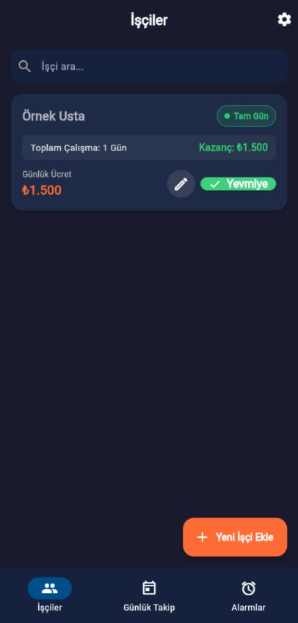
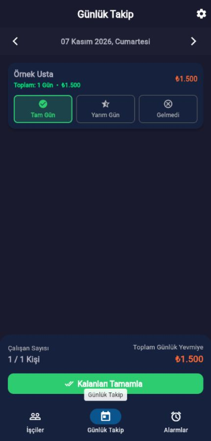

# Yevmiye Takip

**Şantiyede günlük emek ve ücret kayıtlarını düzenli tut.**

Yevmiye Takip, inşaat şantiyeleri için geliştirilen Flutter tabanlı bir işçi ve günlük çalışma takibi uygulamasıdır. İşçi bilgilerini, günlük ücretleri ve tam gün / yarım gün / gelmedi kayıtlarını tek yerde yönetir. Veriler yerel veritabanında tutulur; temel kayıt işlemleri için sunucu hesabı gerekmez.

[Web önizlemesini aç](https://halidenehsen.netlify.app/previews/yevmiye-takip/) · [Portfolyo](https://halidenehsen.netlify.app/)

## Ekran görüntüleri

<p align="center">
  
  
</p>

Görseller çalışan web önizlemesinden alınmıştır. **Örnek Usta** ve gösterilen ücret yalnızca tanıtım verisidir.

## Özellikler

- **İşçi yönetimi:** Ad, isteğe bağlı telefon, günlük ücret ve aktiflik durumu.
- **Günlük takip:** Tarih seçerek tam gün, yarım gün veya gelmedi kaydı oluşturma.
- **Ücret hesabı:** Çalışma kayıtlarına göre gün ve kazanç toplamları.
- **Hızlı işlemler:** İşçi kartından yevmiye yazma ve günlük ekranda kalanları tamamlama.
- **Yerel veri:** SQLite tabanlı saklama; web sürümünde tarayıcı veritabanı adaptörü.
- **Dil seçenekleri:** Türkçe, İngilizce ve Arapça; Arapça sayı biçimlendirme desteği.
- **Mobil yardımcılar:** Alarm ve ses seçimi; JSON yedekleme / geri yükleme akışları.

Örnek kullanım: işçiyi ve günlük ücretini ekle → tarihe göre çalışma durumunu seç → günlük çalışan sayısı ve toplam yevmiyeyi kontrol et.

## Web ve mobil sürüm

Canlı bağlantı, arayüzü ve temel kayıt akışını denemek içindir. Web verileri kullanılan tarayıcıya aittir; tarayıcı verileri temizlenirse kayıtlar kaybolabilir. İlk yükleme, derleme dosyaları ve bağımlılıklar için internet gerekir. Mobilde yerel veritabanı temel kayıtların çevrimdışı kullanılmasını sağlar.

Alarm, bildirim, zil sesi ve dosya paylaşımı platforma bağlıdır; web önizlemesi bunların mobildeki davranışını garanti etmez. JSON yedekleme kodu dosya sistemi kullandığından bu akış özellikle mobil kullanım içindir. Kayıtları korumak için düzenli yedek almak gerekir.

## Teknolojiler

Flutter / Dart, Material 3, Provider, SQLite (`sqflite`), `sqflite_common_ffi_web`, `intl`, yerel bildirim ve alarm paketleri, dosya seçme ve paylaşım araçları.

## Yerelde çalıştır

Güncel Flutter SDK, Dart 3 ve hedef platform araçları gerekir. Kullanılan paketlerin SDK gereksinimleri `pubspec.yaml` ve `pubspec.lock` dosyalarından çözülür.

```bash
git clone https://github.com/Halit1elnehsen/yevmiye-takip.git
cd yevmiye-takip
flutter pub get
flutter run -d chrome
```

Android cihaz veya emülatör ile:

```bash
flutter devices
flutter run -d <device-id>
```

## Derleme

```bash
flutter build apk --release
flutter build web --release
```

Bir alt dizine web yayını için:

```bash
flutter build web --release --base-href /previews/yevmiye-takip/
```

Web'de SQLite worker / WASM dosyalarının da yayınlanması gerekir. Veritabanı paketi için web kurulum dosyaları eksikse kullanılan paket sürümünün kurulum aracıyla oluşturulmalıdır; Flutter'ın `web/` klasörünü ve tam derleme çıktısını birlikte koru.

## Kod yapısı

```text
lib/
  screens/       İşçiler, günlük takip, ayarlar ve alarm ekranları
  providers/     İşçi, çalışma kaydı, ayar, dil ve alarm durumları
  database/      Yerel veritabanı ve tablo işlemleri
  models/        İşçi, günlük kayıt ve alarm modelleri
  utils/         JSON yedekleme ve geri yükleme
  widgets/       İşçi kartları ve ortak arayüz bileşenleri
  theme/         Uygulama teması
docs/images/     README ekran görüntüleri
```

Geliştirici: [Halid Elnehsen](https://github.com/Halit1elnehsen)
