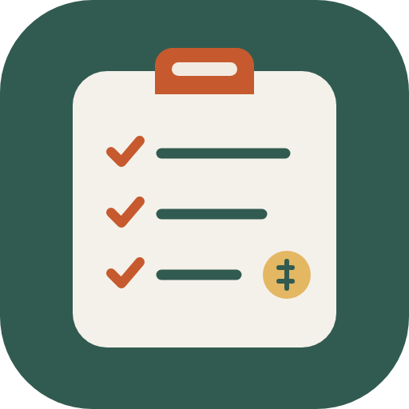
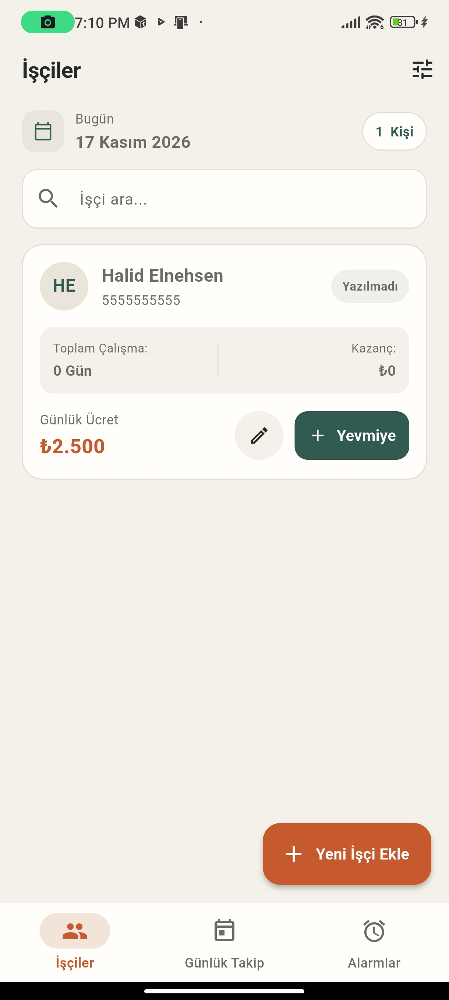
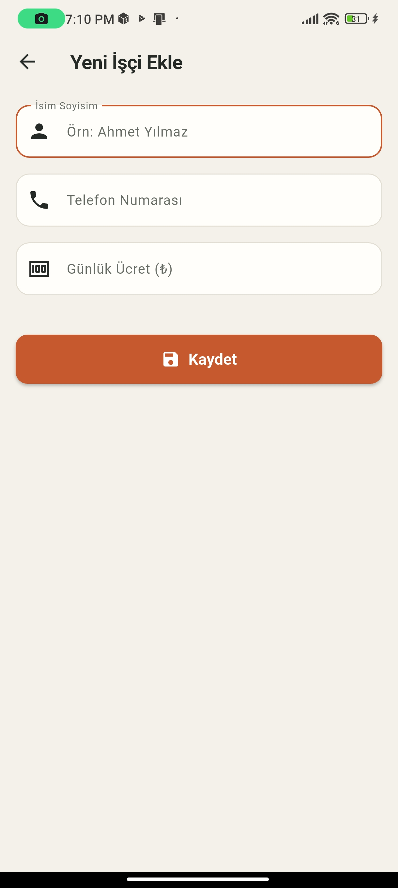
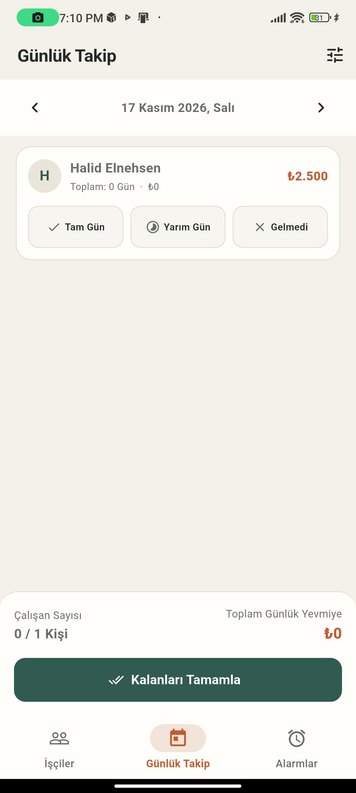
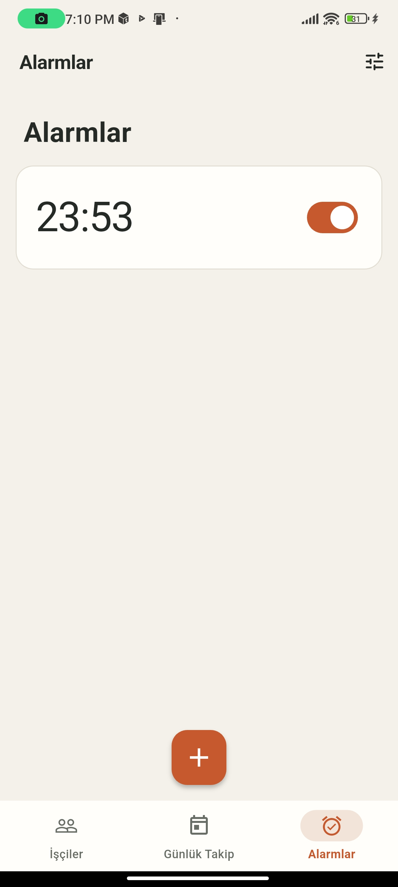

# Yevmiye Takip

Şantiyedeki çalışanları, günlük çalışma durumlarını ve yevmiye kayıtlarını tek yerde takip et.

Yevmiye Takip, Flutter ile geliştirilmiş ve verileri cihazda saklayan bir uygulamadır. Çalışanları ekleyip düzenleyebilir, gün gün tam gün / yarım gün / gelmedi kaydı tutabilir ve günlük toplamları görebilirsin.

[Web önizlemesini aç](https://halidenehsen.netlify.app/previews/yevmiye-takip/) · [Portfolyo](https://halidenehsen.netlify.app/) · [GitHub deposu](https://github.com/Halit1elnehsen/yevmiye-takip)

## Arayüz

Uygulama arayüzü açık krem, orman yeşili ve kiremit tonlarını kullanır. Ayarlardan Türkçe, İngilizce veya Arapça seçilebilir; gece modu tercihi cihazda saklanır.



## Ekran görüntüleri

Aşağıdaki ekranlar uygulamadaki temel kullanım sırasına göre verilmiştir. Her görselin hemen altında o ekranda neler yapabileceğin anlatılır.

### 1. İşçileri görüntüle

<p><a href="docs/images/workers-hd.jpg"></a></p>

Bu ekranda kayıtlı işçileri, günlük ücretlerini ve bugünkü durumlarını görürsün. **Yevmiye** düğmesiyle işçiye hızlıca kayıt ekleyebilir, kalem düğmesiyle bilgilerini düzenleyebilirsin. Yeni bir işçi eklemek için alttaki **Yeni İşçi Ekle** düğmesini kullan.

### 2. Yeni işçi ekle

<p><a href="docs/images/add-worker-hd.jpg"></a></p>

İşçinin adını ve günlük ücretini gir; telefon numarası isteğe bağlıdır. **Kaydet** dediğinde işçi listene eklenir ve günlük takibe hazır olur.

### 3. Günlük çalışmayı kaydet

<p><a href="docs/images/daily-tracking-hd.jpg"></a></p>

Üstteki oklarla tarihi seç. Her işçi için **Tam Gün**, **Yarım Gün** veya **Gelmedi** durumlarından birine dokun. Ekranın altındaki bölüm seçilen gündeki çalışan sayısını ve toplam yevmiyeyi gösterir.

### 4. Alarm kur

<p><a href="docs/images/alarms-hd.jpg"></a></p>

Alarmlar sekmesindeki **+** düğmesiyle hatırlatma oluşturabilirsin. Kurulu alarmı bu listeden açıp kapatabilir, seçtiğin tekrar günlerine göre yevmiye girişini hatırlatabilirsin.

## Ana bölümler

- **İşçiler:** çalışanları, ücretleri ve güncel durumlarını görüntüle; yeni çalışan ekle veya çalışanı pasife al.
- **Günlük Takip:** tarihi seç, çalışanların tam gün / yarım gün / gelmedi durumlarını kaydet ve günlük toplamı incele.
- **Alarmlar:** hatırlatma saatini ve tekrar günlerini seç; sonraki alarm için kalan süreyi gör.

## Özellikler

- Çalışan adı, isteğe bağlı telefon numarası, günlük ücret ve aktiflik durumu.
- Tarihe göre tam gün, yarım gün veya gelmedi kaydı.
- Günlük çalışan sayısı ve yevmiye toplamı.
- Hızlı yevmiye kaydı ve tarih bazlı günlük durum.
- Türkçe, İngilizce ve Arapça arayüz; İngilizcede AM/PM, Arapçada yerel rakam ve gün kısaltmaları.
- Haftanın seçilen günlerinde tekrar eden alarmlar. Seçilmeyen günlerde çalmaz; alarm silinene veya kapatılana kadar tekrar eder.
- Alarm listesinde sonraki çalma zamanına kalan süre.
- Alarm çalarken tam ekran durdurma ve 10 dakika erteleme seçenekleri.
- Uygulama yeniden açıldığında korunan gece modu tercihi.
- SQLite tabanlı yerel veri saklama.

## Alarm ve platform bilgisi

Alarm, bildirim ve tam ekran davranışı mobil işletim sistemine bağlıdır. Android'de bildirim ve tam zamanlı alarm izinlerini aç; Android sürümü isterse tam ekran alarm erişimini de ver. Web önizlemesi arayüzü gösterir, alarm çalmaz. Tarayıcı verileri cihazdaki mobil verilerden ayrıdır.

## Yerelde çalıştır

Güncel Flutter SDK ve Dart 3 gerekir.

```bash
git clone https://github.com/Halit1elnehsen/yevmiye-takip.git
cd yevmiye-takip
flutter pub get
flutter run
```

Android APK derlemek için:

```bash
flutter build apk --debug
```

Portfolyo sitesindeki alt dizin önizlemesini derlemek için:

```bash
flutter build web --release --base-href /previews/yevmiye-takip/
```

Web çıktısını yayınlarken `build/web` içindeki tüm dosyaları, özellikle SQLite WASM ve worker dosyalarını birlikte kopyala.

## Teknolojiler

Flutter, Dart, Material 3, Provider, SQLite (`sqflite`), `sqflite_common_ffi_web`, `intl`, `alarm`, `just_audio` ve `permission_handler`.

## Kod yapısı

```text
lib/
  screens/       İşçiler, günlük takip, ayarlar ve alarm ekranları
  providers/     Çalışan, günlük kayıt, ayar, dil ve alarm durumları
  database/      Yerel veritabanı işlemleri
  models/        Çalışan, günlük kayıt ve alarm modelleri
  widgets/       Ortak arayüz bileşenleri
  theme/         Açık ve koyu tema
docs/images/     Uygulama ekran görüntüleri
```

Geliştirici: [Halit Elnehsen](https://github.com/Halit1elnehsen)
